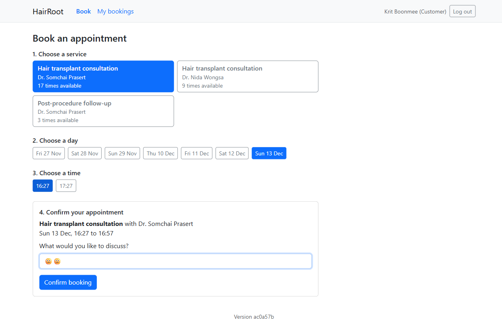
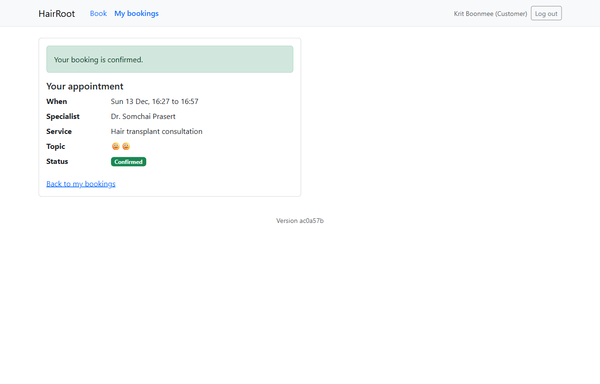
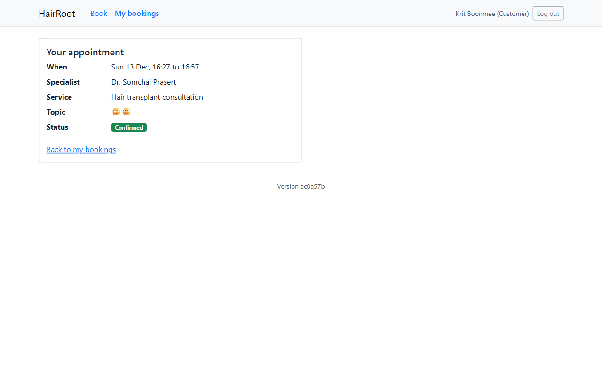

# HR-F01 - two-symbol Unicode topic creates a confirmed booking

Status at the original R01 report: **observed finding, awaiting HairRoot triage**. Later on 26 November the Product Team's [open report PR #56](https://github.com/alvin777777/hairroot/pull/56) recorded it as **Accepted defect / Minor**; see the source-qualified [follow-up](follow-up-2026-11-26.md). A canonical Issue number, corrected release and independent retest remain pending. No direct message by this agent or final acceptance is inferred. Tracking: DineQ [L6-4 / #48](https://github.com/PpAnpt/dineq/issues/48). Product owner: HairRoot, team หัวล้านได้หวี. Reporter: DineQ; Playwright-assisted observation requested by Siwarak Chatvichai / BBINGOAL, who performed the private test logins. Anapat's execution contribution is not yet recorded.

## Requirement, version and impact

- Source: [HairRoot UAT v0.2](reference/hairroot-uat-cases-v0.2.md), UAT-07 steps 2/3; BR-08 / AC-15b. Topic length must be 3-200 characters after trimming. Two `🙂` symbols must be rejected without creating a booking or consuming the time.
- Tested URL: <https://hairroot-368003298307.asia-southeast1.run.app>. Observed footer throughout: `Version ac0a57b`. Partner-declared full commit: `ac0a57b9eb871128807733a0e9d75d77a662b477`; revision: `hairroot-sha-ac0a57b9eb87-44992339630-1`. The revision was not queried through authenticated GCP access by this task.
- Actual failure capture: **26 November 2026, 11:03:39.945 UTC / 18:03:39.945 Asia/Bangkok**. A fresh detail read at 11:06:04.703 UTC still showed the invalid topic as Confirmed.
- R01 suggested severity: **Minor**; the later open partner report records the same severity. This is a specific input-boundary violation: invalid Unicode topics are persisted and consume a slot. No authorization bypass, data loss or failure of the ordinary valid-topic booking path was observed. Product Team triage is not independent acceptance of a known limitation; DineQ would have to explicitly record any such decision.

## Preconditions and reproduction

1. Use the identified HairRoot release and source's private synthetic accounts: S1 Specialist and C3 Customer. No password is included here.
2. As S1, create an unused consultation time 10-30 days ahead, 30 minutes, then log out. In this attempt D7 was **13 December 2026**, T7A **16:27-16:57**, service **Hair transplant consultation / Dr. Somchai Prasert**. Both the Specialist and Customer views showed it Available before the attempt. Do not repeat against the now-booked fixture; use a newly agreed unused synthetic slot.
3. As C3 (**Krit Boonmee**), select the service, day and T7A. Before the attempt, My bookings showed no bookings.
4. Enter exactly `🙂🙂` in **What would you like to discuss?** and click **Confirm booking**. The saved pre-submit screenshot shows the exact two-symbol input. Each symbol is a single Unicode code point; this string is two code points but four JavaScript UTF-16 code units.
5. Open My bookings, then reopen the created detail page to check persistence. Reopen Book for the same day to check whether T7A remains selectable.

**Expected:** message `Enter a topic of 3 to 200 characters.`; no confirmation page/booking; T7A remains Available; My bookings has no T7A entry.

**Actual:** confirmation page opened at **`/bookings/2`**, displayed the exact topic `🙂🙂`, Status **Confirmed**, and 13 December 16:27-16:57. My bookings listed it after fresh navigation. Reopening `/bookings/2` still showed Confirmed. T7A disappeared from the available-time choices; the untouched T7B 17:27-17:57 was still selectable. The rejection message did not appear.

Positive control from the supplied case: the separate T7B was submitted with `🙂🙂🙂`; **`/bookings/3`** confirmed and displayed all three symbols unchanged, including after reload. In the final private S1 login, the Specialist schedule showed **both T7A and T7B Booked under Krit**, including the two-symbol and three-symbol topics respectively. Thus source steps 2, 3 and 5 fail for the same underlying HR-F01; step 4's positive booking/logout succeeds.

## Evidence

| ID | Observation |
| --- | --- |
| HR-E07-01B-R01 | S1 before-state: T7A and T7B both Available |
| HR-E07-BEFORE-R01 | C3 My bookings empty before the attempt |
| HR-E07-02-INPUT-R01 | Exact two-symbol topic on the selected T7A form |
| HR-E07-02-AFTER-R01 | Unexpected confirmation of booking 2 with `🙂🙂` |
| HR-E07-03-R01 | Booking 2 listed after fresh My bookings navigation |
| HR-E07-02-AVAILABILITY-R01 | T7A absent, T7B still selectable after the invalid request |
| HR-E07-02-PERSISTED-R01 | Fresh read of `/bookings/2`: same date/time/topic, Confirmed |
| HR-E07-04-INPUT-R01 / HR-E07-04-AFTER-R01 / HR-E07-04-RELOAD-R01 | Separate three-symbol positive control, booking 3 and unchanged detail after reload |
| HR-E01-07-R01 | Final S1 read-back also supports UAT-07 step 5: both Unicode slots Booked; T7A should have remained Available |

Selected screenshots and sanitized machine-readable records are in [the evidence directory](../../evidence/lab6/hairroot-20261126/finding-HR-F01.json). That record identifies exact UTC times, URLs, observed text and original screenshot/observation SHA-256 values. No correct password, token, cookie, authentication header or private Cloud Shell output is included.

## Source inspection supporting the likely cause

Read-only inspection of [HairRoot's booking input parser at the candidate commit](https://github.com/alvin777777/hairroot/blob/ac0a57b9eb871128807733a0e9d75d77a662b477/server/src/services/bookings.ts) found the 3-200 check uses `topic.length`. JavaScript counts UTF-16 code units, so `🙂🙂` has length 4 and passes that lower bound. This is consistent with the actual UI/persistence failure. The inspection is supporting analysis, not a replacement for the live observations, and it does not independently verify the deployed image digest.

HairRoot should reproduce with an automated test first, confirm the agreed Unicode counting rule, then correct validation and retain the same assertions through RED/GREEN/regression. Include the two-/three-symbol boundaries and the upper boundary as applicable. No HairRoot source was changed by this task.

## Data retained and next action

Bookings **2** (invalid two-symbol input) and **3** (valid three-symbol control) remain as synthetic evidence under C3. No deletion, cancellation, reseed, counter reset or partner cloud action was performed. The source provides no cancellation workflow. Coordinate any fixture handling/retest with HairRoot; a corrected test needs a fresh unbooked fixture and a new attempt ID. Retain the original FAIL evidence.

The later partner-authored open report corroborates receipt/classification as Accepted defect / Minor and names Tithinan as owner. Its Issue number, fix chain and retest are explicitly pending; no direct-chat delivery/acknowledgement by this agent is invented. Record the actual canonical Issue/corrected release when available. This is a finding about **HairRoot**, not a DineQ defect or DineQ RED/GREEN exercise. The [full assisted run](hairroot-run-2026-11-26-R01.md) remains 5 PASS / 1 FAIL / 1 BLOCKED cases; overall independent acceptance is pending actual student contributions, defect resolution/retest and the required owner-announced persistence operation. Follow-up status does not change any original observation.
