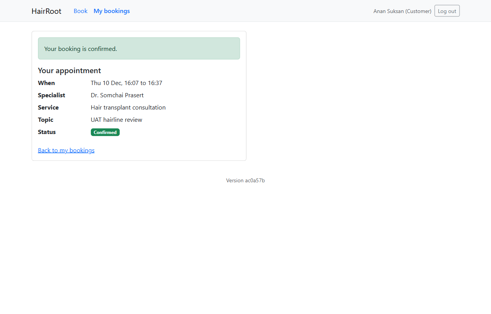
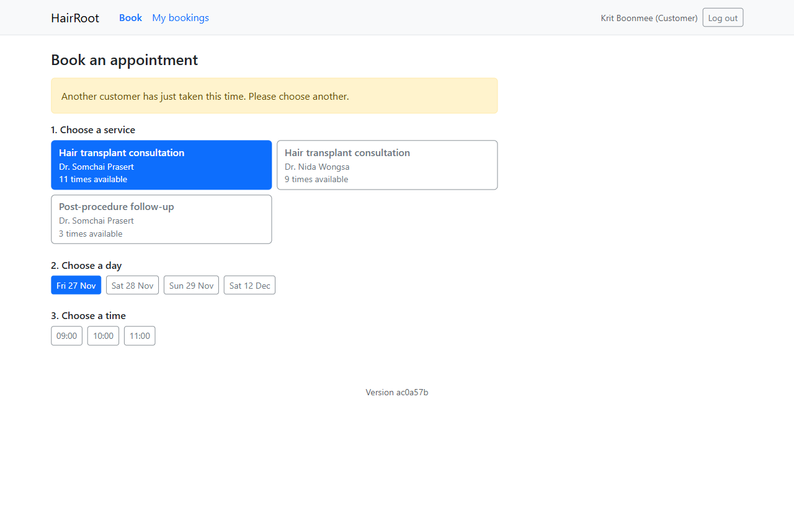
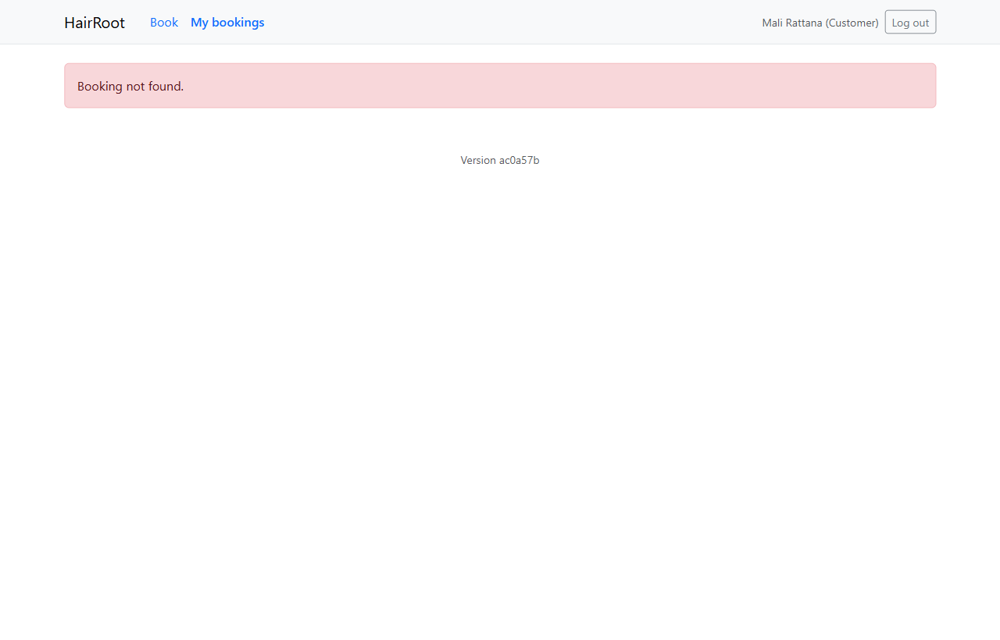
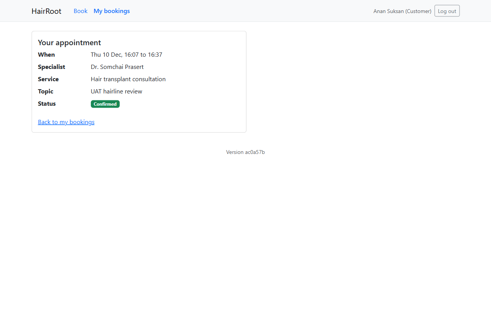

# HairRoot UAT assisted run - 26 November 2026, R01

Tracking: [L6-4 / #48](https://github.com/PpAnpt/dineq/issues/48). Source: [partner v0.2](reference/hairroot-uat-cases-v0.2.md), SHA-256 `82e9981d1aca88f0a31c830279b45aaa8431befc1aaebcd88377e6ccdfb29938`. Expected actions below are taken from the [execution template](hairroot-execution.md); Actual records are generated from captured observations, not copied from Expected.

## Result and participation

Later status/provenance is in the [26 November follow-up](follow-up-2026-11-26.md): reviewed integration, partner-draft HR-F01 triage and a later public full-commit check. The R01 observations/counts below are unchanged. Use the [caption register](evidence-captions.md) for actual time, URL, actor and version beside every selected image in the PDF.

**Seven cases: 5 PASS, 1 FAIL, 1 BLOCKED. Forty-three steps: 39 PASS, 3 FAIL, 1 BLOCKED.** The three failing steps are manifestations of one finding, [HR-F01](hairroot-finding-HR-F01.md), not three defects. These are browser-assisted functional outcomes; they are not a final independent acceptance or a claim that both students executed every case.

Siwarak / BBINGOAL requested testing, privately entered the S1/C1/C2/C3/S2 credentials and confirmed successful logins. Playwright drove the recorded actions and observations. The actual account operator is identified per step/evidence. Anapat execution participation is not recorded; teammate review is still required. No correct password, cookie, token, storage state or authentication header was read into this evidence.

The live pages displayed Version ac0a57b throughout. Candidate full commit `ac0a57b9eb871128807733a0e9d75d77a662b477` and revision `hairroot-sha-ac0a57b9eb87-44992339630-1` are partner-declared; authenticated GCP image/revision metadata was not queried. A two-team freeze acknowledgement is not recorded. Date/clock evidence identifies what was actually observed, without assuming a source-document date proves execution.

Captured observation interval: `2026-11-26T10:46:24.847Z` to `2026-11-26T11:26:54.534Z` (UTC; add seven hours for Asia/Bangkok). Actual test date is 26 November; the earlier planned 25 November date is not represented as an executed run.

| Case | Result | Main observation |
| --- | --- | --- |
| UAT-01 | PASS | New normal booking 4 confirmed, retrieved through its list link and visible to S1 |
| UAT-02 | PASS | C2 booking 7 wins; stale C3 request rejected; winner/loser lists agree. Sequential stale-choice check, not true concurrency |
| UAT-03 | PASS | Past/overlap rejected; adjacency/15/120 accepted; ASCII 2/201 rejected, 3/200 accepted; exactly two D3 bookings |
| UAT-04 | PASS | C2 cannot read C1 booking 4 or Specialist page; anonymous access redirects; S2 sees only its own schedule; C1 record unchanged afterward |
| UAT-05 | BLOCKED | Fresh C1 session and C3/S1 reads retain the normal booking; no owner-announced redeployment was provided for step 4 |
| UAT-06 | PASS | Wrong/unknown generic rejection, correct C1 role, logout then Back/reload returns login |
| UAT-07 | FAIL | Two-symbol topic stored as booking 2 and consumed T7A; three-symbol control booking 3 works; S1 confirms both Booked |

## Method and actual order

Runtime: Node v24.14.0, Playwright 1.65.0, installed Chrome 158.0.8127.38. Interactive commands ran through the local Playwright helpers, now preserved as evidence (`node <helper-path>` from the repository root). They default to the named live HairRoot origin and **do not perform a test unless commands are supplied**; do not replay mutating commands against already-used fixtures. No correct credential was supplied through or logged by the command protocol; the student used the visible login form privately.

S1 fixture preparation was grouped, then C3 Unicode checks, C1 normal/ASCII/logout checks, separate C2/C3 stale-choice checks, S2 isolation, S1 after-state and a new Chrome process/context for fresh C1 verification. This grouping differs from a strictly sequential case-by-case script and is recorded instead of inventing timestamps/order. C2/C3 used separate isolated contexts/processes, not two tabs sharing a session.

UAT-03 step 7 inspected the rendered native select options through Playwright rather than visually expanding the dropdown. This proves the offered UI options, not backend rejection of unselectable values. UAT-02 is deliberately sequential; no 20-request concurrency claim is made. Owner/authorization outcomes are UI observations; no HTTP status is inferred where only the visible message/redirect was captured.

## Complete per-step record

| Case / step | Source action | Expected | Actual observed | Result | Evidence |
| --- | --- | --- | --- | --- | --- |
| UAT-01 / 1 | Sign in as S1 | "My schedule" page opens | S1 private login opened My schedule as Dr. Somchai Prasert (Specialist). | PASS | HR-E01-01-R01 |
| UAT-01 / 2 | Service "Hair transplant consultation", date D, start T, 30 minutes, Add time | "Time added." appears; T to T+30 is listed under D as Available | 10 Dec 16:07-16:37 added; Time added. and Available displayed. | PASS | HR-E01-02-R01 |
| UAT-01 / 3 | Log out; sign in as C1 | "Book an appointment" page opens | S1 was logged out; private C1 login in a separate isolated context opened Book as Anan Suksan (Customer). | PASS | HR-E04-04-R01, HR-E01-03-R01 |
| UAT-01 / 4 | Choose the S1 consultation service, day D, time T | Step 4 shows the service, the specialist and D, T to T+30 | Selected S1 consultation and 10 Dec 16:07-16:37 were shown in the confirmation form. | PASS | HR-E01-04-R01 |
| UAT-01 / 5 | Topic `UAT hairline review`, Confirm booking | "Your booking is confirmed." with When, Specialist, Service, Topic, Status Confirmed | Normal topic produced booking 4, Confirmed, with correct date/time/service/Specialist/topic. | PASS | HR-E01-05-R01 |
| UAT-01 / 6 | My bookings, then open the new booking | It is listed and opens with the same details | Booking 4 appeared in My bookings; clicking its link reopened the same details. | PASS | HR-E01-06-LIST-R01, HR-E01-06-DETAIL-R01 |
| UAT-01 / 7 | Log out; sign in as S1 | Under D, T to T+30 shows Booked, the customer name and the topic | A later S1 login showed 10 Dec 16:07-16:37 Booked under Anan with UAT hairline review. | PASS | HR-E01-07-R01 |
| UAT-02 / 1 | Window A: sign in as C2. Window B: sign in as C3 | (setup step; no expected result stated in HairRoot's source) | C2 Mali and C3 Krit were logged in in separate isolated Chrome contexts/processes. | PASS | HR-E02-01-R01, HR-E02-C3-READY-R01 |
| UAT-02 / 2 | In both windows choose the S1 consultation service, day D2, time T2 and enter that window's topic; do not confirm yet | (setup step; no expected result stated in HairRoot's source) | Both forms were staged on the same 11 Dec 16:17-16:47 slot, with their respective source topics. | PASS | HR-E02-C2-READY-R01, HR-E02-C3-READY-R01 |
| UAT-02 / 3 | Window A: Confirm booking | C2's booking is confirmed | C2 confirmed first: booking 7, Confirmed, topic UAT race C2. | PASS | HR-E02-03-R01 |
| UAT-02 / 4 | Window B: Confirm booking | "Another customer has just taken this time. Please choose another."; T2 is no longer offered for D2 | Stale C3 confirmation showed Another customer has just taken this time. Please choose another.; D2/T2 disappeared. | PASS | HR-E02-04-R01 |
| UAT-02 / 5 | Window B: My bookings | No booking for D2, T2 | C3 list contained only its two existing 13 Dec Unicode fixtures, with no 11 Dec booking. | PASS | HR-E02-05-R01 |
| UAT-02 / 6 | Window A: My bookings | C2's booking for D2, T2 is still there with topic `UAT race C2` | C2 list retained the single 11 Dec 16:17 booking with UAT race C2. | PASS | HR-E02-06-R01 |
| UAT-03 / 1 | S1: yesterday's date, 10:00, 30 minutes, Add time | "A slot must start in the future."; nothing added | Yesterday 25 Nov 10:00 rejected with A slot must start in the future.; visible Available count unchanged. | PASS | HR-E03-01-R01, HR-E01-02-R01 |
| UAT-03 / 2 | Add D3, 17:00, 60 minutes | "Time added." | 12 Dec 17:00-18:00 added Available. | PASS | HR-E03-02-R01 |
| UAT-03 / 3 | Add D3, 17:30, 30 minutes | "This time overlaps another slot on the schedule."; nothing added | 17:30 overlap rejected with the specified message; no 17:30 entry and Available count unchanged. | PASS | HR-E03-03-R01, HR-E03-02-R01 |
| UAT-03 / 4 | Add D3, 18:00, 30 minutes (starts exactly when 17:00 ends) | "Time added." (adjacent times allowed) | Adjacent 18:00-18:30 accepted and displayed Available. | PASS | HR-E03-04-R01 |
| UAT-03 / 5 | Add D3, 19:00, 15 minutes | "Time added", shown as 19:00 to 19:15 | 15-minute lower boundary accepted as 19:00-19:15. | PASS | HR-E03-05-R01 |
| UAT-03 / 6 | Add D3, 20:00, 120 minutes | "Time added", shown as 20:00 to 22:00 | 120-minute upper boundary accepted as 20:00-22:00. | PASS | HR-E03-06-R01 |
| UAT-03 / 7 | Open the Duration list | Only 15, 30, 45, 60, 90 and 120 minutes are offered | Rendered native Duration options inspected through Playwright DOM: 15,30,45,60,90,120 only; no backend 14/121 test claimed. | PASS | HR-E03-06-R01 |
| UAT-03 / 8 | Log out; sign in as C1; choose the S1 consultation service, D3, 18:00; topic `ab`; confirm | "Enter a topic of 3 to 200 characters." under the topic; no booking made | ASCII ab rejected with Enter a topic of 3 to 200 characters.; stayed on booking form. | PASS | HR-E03-08-R01 |
| UAT-03 / 9 | Replace the topic with the 201-character topic; confirm | The same message; no booking made | Exactly 201 ASCII characters rejected with the same topic validation message. | PASS | HR-E03-09-R01 |
| UAT-03 / 10 | Replace it with the 200-character topic; confirm | Booking confirmed; its detail shows the full topic | Exactly 200 source digits accepted as booking 5; detail text equals the complete 200-character input. | PASS | HR-E03-10-INPUT-R01, HR-E03-10-R01 |
| UAT-03 / 11 | Choose D3 and 19:00; topic `abc`; confirm | Booking confirmed | ASCII abc accepted as booking 6 at 19:00-19:15. | PASS | HR-E03-11-R01 |
| UAT-03 / 12 | My bookings | Exactly two bookings on D3 (18:00 and 19:00); none for the rejected attempts | C1 list has exactly two 12 Dec bookings, 18:00 and 19:00, and no extra rejected-attempt booking. | PASS | HR-E03-12-R01 |
| UAT-04 / 1 | Sign in as C1, open one of C1's bookings, copy its address, log out | (setup step; no expected result stated in HairRoot's source) | Recorded C1-owned /bookings/4 and its details, then C1 logged out. | PASS | HR-E04-01-R01, HR-E06-04-R01 |
| UAT-04 / 2 | Sign in as C2 and open the copied address | "Booking not found."; no topic, time or name of C1 shown | C2 saw Booking not found. at /bookings/4 with no C1 name/topic/time. Later fresh C1 read-back has identical booking fields. | PASS | HR-E04-02-R01, HR-E05-01-DETAIL-R01 |
| UAT-04 / 3 | As C2 open `<URL>/schedule` | C2 is sent to the booking page; no specialist schedule or other customers' bookings shown | C2 /schedule redirected to /slots; no Specialist schedule/private booking list was displayed. | PASS | HR-E04-03-R01 |
| UAT-04 / 4 | Log out; without signing in open `<URL>/bookings` | The sign-in page is shown | Signed-out /bookings redirected to /login without private booking details. | PASS | HR-E04-04-R01 |
| UAT-04 / 5 | Sign in as S2; open the Service list on "My schedule" | Only S2's own service is listed; none of S1's bookings or customer names appear | S2 Dr. Nida sees only its consultation schedule option 3; no S1 Customer names or test topics. | PASS | HR-E04-05-R01 |
| UAT-05 / 1 | Sign in as C1 in a fresh private window; open My bookings | The UAT-01 booking is listed with the same date, time and topic | New Chrome process/isolated context with private C1 login listed booking 4 and reopened identical details. | PASS | HR-E05-01-LIST-R01, HR-E05-01-DETAIL-R01 |
| UAT-05 / 2 | Log out; sign in as C3; choose the S1 consultation service and day D | Time T is not offered | C3 could not select normal-journey 10 Dec 16:07; the day disappeared because its only slot was booked. | PASS | HR-E05-02-R01 |
| UAT-05 / 3 | Log out; sign in as S1 | D, T still shows Booked with C1's name and topic | S1 read-back still showed the original normal booking under Anan with unchanged time/topic. | PASS | HR-E01-07-R01 |
| UAT-05 / 4 | After HairRoot announces a redeployment and says it is finished, repeat steps 1 to 3 (record the version before and after) | The same results: the data survived the redeployment | No HairRoot-owner-announced redeployment/before-after operation was provided to this run. No cloud operation was attempted; reload/new session is not redeployment proof. | BLOCKED | Unmet prerequisite; no operation |
| UAT-06 / 1 | Open `<URL>/login`; C1's email and `Wrong-Pass1`; Sign in | "Invalid email or password."; stay on the sign-in page | Known C1 email with the published deliberately wrong example displayed Invalid email or password. and stayed on login. | PASS | HR-E06-01-R01 |
| UAT-06 / 2 | Unknown email `nobody@hairroot.test` with any password | The same message (does not reveal whether the account exists) | Unknown email displayed the identical generic invalid-credentials message. | PASS | HR-E06-02-R01 |
| UAT-06 / 3 | Sign in with C1's correct password | The booking page opens; the header shows the Customer name and role | Private correct C1 login opened Book and showed Anan Suksan (Customer). | PASS | HR-E01-03-R01 |
| UAT-06 / 4 | Log out; press Back; reload | The sign-in page, not C1's data | C1 logout, Back and reload ended at login with no C1 details. | PASS | HR-E06-04-R01 |
| UAT-07 / 1 | Sign in as S1; add T7A and T7B on D7 to Hair transplant consultation, each 30 minutes; log out | "Time added." for each; both Available | S1 added both fresh 13 Dec 30-minute fixtures, T7A 16:27 and T7B 17:27, then logged out. | PASS | HR-E07-01A-R01, HR-E07-01B-R01, HR-E04-04-R01 |
| UAT-07 / 2 | Sign in as C3; select the same service, D7, T7A; enter `🙂🙂`; Confirm booking | "Enter a topic of 3 to 200 characters."; confirmation page does not open; T7A stays available | Two symbols 🙂🙂 unexpectedly confirmed booking 2 at T7A; the required rejection message did not appear. | FAIL | HR-E07-02-INPUT-R01, HR-E07-02-AFTER-R01, HR-E07-02-PERSISTED-R01 |
| UAT-07 / 3 | Open My bookings, then return to Book | No booking for D7/T7A | My bookings listed the invalid two-symbol T7A booking instead of having no such entry. | FAIL | HR-E07-03-R01 |
| UAT-07 / 4 | Choose the same service, D7, T7B; enter `🙂🙂🙂`; confirm; log out | Booking confirmed; detail shows the three symbols unchanged | Three symbols 🙂🙂🙂 confirmed separate booking 3, unchanged after reload; C3 later logged out. | PASS | HR-E07-04-INPUT-R01, HR-E07-04-AFTER-R01, HR-E07-04-RELOAD-R01, HR-E07-04-LOGOUT-R01 |
| UAT-07 / 5 | Sign in as S1; open D7 on My schedule | T7A Available; T7B Booked with C3 and the three-symbol topic | S1 sees both T7A and T7B Booked under Krit; T7A should have remained Available. Same HR-F01 defect, not a second issue. | FAIL | HR-E01-07-R01 |

## Retained synthetic fixtures

Eight new S1 consultation slots and six new bookings were created only through the normal UI. Pre-existing seed records were not deleted/rewritten. Slots and bookings remain as source-authorized synthetic evidence; no cancellation, SQL, migration, reseed, code change or cloud operation was performed. All private test sessions were logged out and their isolated browser processes closed after observation.

| Date (Bangkok) | Slot | Last state / retained booking |
| --- | --- | --- |
| 10 Dec 2026 | 16:07-16:37 | Booked, C1 booking 4, UAT hairline review |
| 11 Dec 2026 | 16:17-16:47 | Booked, C2 booking 7, UAT race C2; C3 owns no matching booking |
| 12 Dec 2026 | 17:00-18:00 | Available overlap baseline |
| 12 Dec 2026 | 18:00-18:30 | Booked, C1 booking 5, exact 200-digit topic |
| 12 Dec 2026 | 19:00-19:15 | Booked, C1 booking 6, abc |
| 12 Dec 2026 | 20:00-22:00 | Available maximum-duration fixture |
| 13 Dec 2026 | 16:27-16:57 | Booked, C3 booking 2, invalid two-symbol topic retained for HR-F01 |
| 13 Dec 2026 | 17:27-17:57 | Booked, C3 booking 3, valid three-symbol control |

Do not rerun by recreating these times or deleting their history. A corrected attempt needs owner-agreed unused fixtures and a new attempt ID, retaining this original FAIL.

## Selected readable evidence

Exact time, URL, actor and original screenshot/observation hashes for every referenced ID are in [run-summary.json](../../evidence/lab6/hairroot-20261126/run-summary.json). Selected password-free PNGs are committed; full original captures stay in the ignored local evidence directory. Reused captures support multiple observations without pretending those occurred at different times. Complete finding screenshots are embedded in [HR-F01](hairroot-finding-HR-F01.md).

**HR-E01-05-R01:** Normal journey: C1 booking confirmed with the supplied topic.

**HR-E02-04-R01:** Negative stale-choice check: C3 is rejected after C2 wins.

**HR-E04-02-R01:** Ownership: C2 sees Booking not found., without C1 details.

**HR-E05-01-DETAIL-R01:** Fresh C1 session: identical normal booking remains Confirmed.

## Findings, dependencies and next work

One outgoing finding is drafted: **HR-F01**, proposed Minor subject to HairRoot triage, linked to UAT-07 / BR-08 / AC-15b. No partner Issue/notification or acknowledgement is fabricated. HairRoot must classify/respond and provide an exact corrected version for independent retest; any uncorrected minor limitation needs explicit independent UAT Team agreement. This report does not supply that agreement.

UAT-05 step 4 remains BLOCKED until HairRoot announces/performs a real redeployment and the independent team repeats the original C1/C3/S1 observations with recorded before/after versions. Reload/new login and earlier Lab5 evidence do not satisfy it. This task did not operate partner cloud resources.

Formal independent acceptance remains **PENDING**: there is a known failure, a required blocked persistence step, missing partner disposition/notification and no recorded second-student execution contribution. Do not mark #48 or Lab6 complete from this report alone. The DineQ team tests HairRoot; this finding is not a DineQ defect or its required RED/GREEN chain. DineQ still needs HairRoot's actual results, and a TA-approved isolated exercise if its own release has no legitimate defect.
