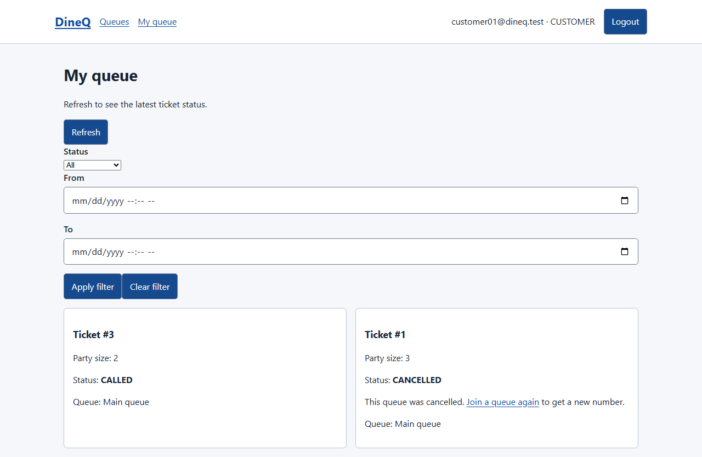
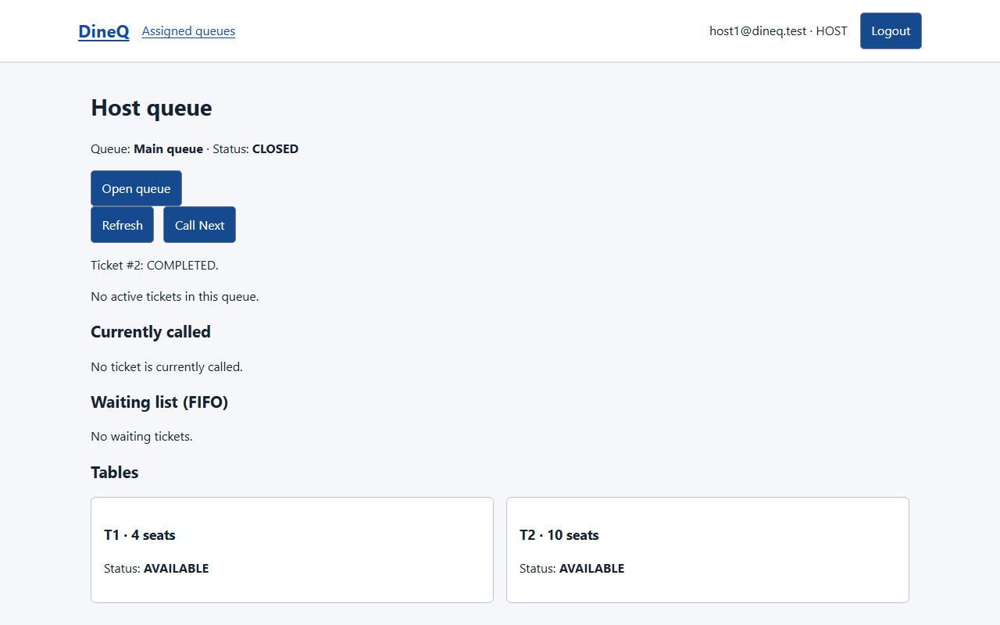
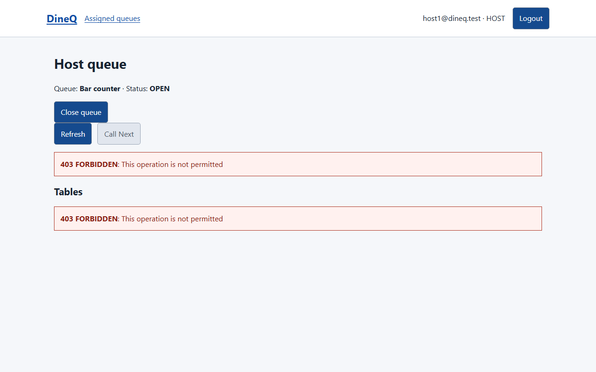
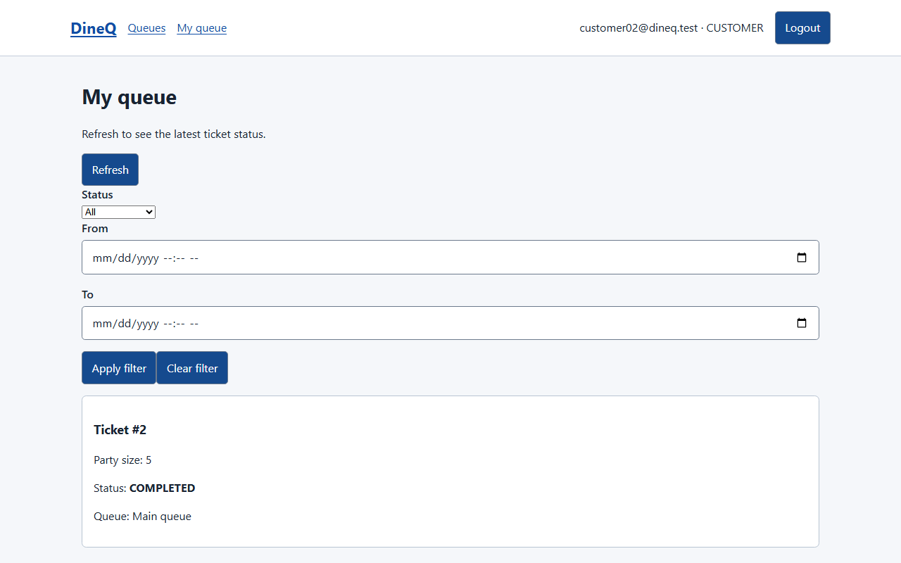

# Siwarak's contribution and selected evidence — Deliverable 2

Author/student responsible: Siwarak Chatvichai, 67070501086, GitHub BBINGOAL. Group TH-007_P9. This is source material for the team's PDF, not a replacement for Parts A–E. Work was assisted by Codex under Siwarak's direction; recorded browser actions below are automated, not a student-performed manual audit.

## Contribution boundary

| Work | Responsibility and evidence |
| --- | --- |
| F-05 contract | Authored no-show/table/Seat/Release contract #104, revised after Anapat's test-impact/check-order feedback |
| F-05 implementation | #107: migration 004, insert-only table seed, service/routes, API/DB tests and Host/Customer UI. Review fix requires an active HOST assignment and respects search_path. Final feature evidence: [F-05 verification](../../evidence/f05-verification.md), source 1a3d66dfa57e47df1999c215f24e26ef1577419f; 257 API passes and 10 browser passes. Anapat independently reran the final feature |
| F-09a | #105: structured 413 PAYLOAD_TOO_LARGE with unchanged auth/resource precedence. [RED](../../evidence/f09-payload-red.txt): 2 failed / 121 passed; [GREEN](../../evidence/f09-payload-green.txt): 123 passed at e75a5989f909a5ebcf08041085a861a34596dc90 |
| Reviews of teammate work | Contract/implementation reviews of #98/#99/#100/#101/#103/#106/#108/#109/#112/#114; substantive findings include the cancellation CALLED guard, collision-safe queue-name backfill, preserving maxPartySize, under-lock limit changes, NULL event transitions and timestamp precision. These were reviews of Anapat's work, not authorship of those implementations |
| Release preparation | Opened #120 with exact evidence/source mapping and PpAnpt as reviewer. PpAnpt approved and merged; the assistant did not merge or deploy. Main f3e7c637457dd4f1f78e9bfabda513359fbcb538 was deployed by the existing pipeline |
| B3 cross-feature regression | Added E2E-12..15 in a separate file after checking teammate PRs/branches; existing 11 browser tests and application code retained. This is supplemental regression after implementation, not a new feature RED/GREEN cycle |

The earlier integration evidence by Anapat remains [s2-integration](../../evidence/s2-integration.txt) at 5e8c9a7 and [s2-e2e](../../evidence/s2-e2e.txt) at b05cbd5 (289 API and 11 browser passes). Do not attribute those original runs to Siwarak or replace their immutable evidence files.

## B3 run ledger

Source for both successful full runs: d7f31d4c87e6d98d18da51b1780eae76d9dfd1a8 (the same full SHA in both run headers). Application/migrations are unchanged from the released candidate; only regression tests, evidence and these report sources are added.

| Run | Result | Scope |
| --- | --- | --- |
| Focused first attempt | 4 failed | Helper matched both h2 and h3; genuine new-test locator bug, not a product defect or original RED evidence |
| Focused corrected run | 4 passed | Same expected states, narrowed selector to ticket h3 |
| [First full API record](../../evidence/s2-cross-feature-api.txt) | 288 passed / 1 failed / 0 skipped | INFRA-11 expected Origin localhost:5173 but the local .env had the E2E port; product correctly returned ORIGIN_NOT_ALLOWED |
| [API after environment correction](../../evidence/s2-cross-feature-api-env-fix.txt) | 289 passed / 0 failed / 0 skipped | Only ignored local APP_ORIGIN corrected; no assertion/application edit |
| [Full browser record](../../evidence/s2-cross-feature-e2e.txt) | 15 passed / 0 failed / 0 skipped / 0 flaky | Includes all original journeys plus four new cross-feature cases |
| [Local serving/helper checks](../../evidence/s2-cross-feature-checks.txt) | 16 passed / 0 failed / 0 skipped | In-process Express/Supertest and offline evidence helpers; not deployed checks |

Build succeeded from npm ci in the separate test/s2-e2e worktree. The new database/container and dynamic ports are local only. NODE_ENV production in an in-process serving test is not evidence of a production deployment probe.

## Captioned browser captures

All images are automated local Chromium captures from the recorded cross-feature suite, with synthetic seed accounts. The test-run header provides ISO time, Node version and full source commit. No password or session cookie is shown. The image demonstrates the visible state; request assertions and SQL snapshots in the corresponding test establish the preceding transition and lack of side effects.

### E-S2-12: cancellation and FIFO after rejoin

AC-28/33/15/16; Customer 01 and Customer 02 with assigned Host 1. Ticket 1 is cancelled, its owner rejoins as ticket 3, Host serves ticket 2 before ticket 3, and the CALLED guard rejects an extra call. After Refresh the owner sees old ticket 1 CANCELLED and new ticket 3 CALLED. This is local evidence, not a production read-back.



### E-S2-13: CLOSED does not prevent serving existing tickets

AC-49/15/17; Host 1 closes a queue holding two WAITING tickets. A new Customer Join gets 409 QUEUE_CLOSED and an identical queue/ticket/event SQL snapshot; Host completes tickets 1 and 2 in FIFO order while status stays CLOSED and next_ticket_no stays 3.



### E-S2-14: forbidden access across queues

AC-48/50/38; Host 1 belongs to Main queue, Host 3 to Bar counter. Host 1's GET entries/tables, POST call-next and PATCH status for Bar counter all return 403; SQL snapshots remain identical. The image shows the backend error. Host 3 then successfully calls its own ticket while Main queue's ticket remains WAITING.



### E-S2-15: terminal history after No-show, Seat and Release

AC-36/40/42/43; ticket 1 becomes NO_SHOW, its owner rejoins as ticket 3, and FIFO selects ticket 2 (party 5). T1/4 seats is excluded; Host seats at T2/10, then releases it. Customer 02 Refresh shows ticket 2 COMPLETED, the historical table_id stays T2, and Customer 01 retains NO_SHOW plus WAITING history.



## Two actual automated-test excerpts

Domain rule — from E2E-13, setup has two WAITING tickets and Host has closed the queue:

```js
const before = await snapshot();
const rejected = await newcomer.request.post(`/api/queues/${seedIds.queue}/entries`, {
  headers: { Origin: new URL(newcomer.url()).origin }, data: { partySize: 1 },
});
expect(rejected.status()).toBe(409);
expect((await rejected.json()).error.code).toBe('QUEUE_CLOSED');
expect(await snapshot()).toEqual(before);
await call(host, 1);
await complete(host, 1);
await call(host, 2);
await complete(host, 2);
```

Access restriction — from E2E-14, signed-in Host 1 is assigned only to Main queue; Bar counter has a different assigned Host:

```js
for (const path of ['entries', 'tables']) {
  const response = await host.request.get(`/api/queues/${seedIds.barQueue}/${path}`);
  expect(response.status()).toBe(403);
  const json = await response.json();
  expect(json).toEqual({ error: { code: 'FORBIDDEN', message: 'This operation is not permitted' } });
}
```

These are excerpts from [the actual test file](../../../client/e2e/sprint-2-cross-feature.spec.js), not pseudocode. The full file also checks mutation rejection and unchanged database snapshots. Results belong to the full browser record above; they do not establish all possible permission inputs.

## Release evidence and limits

Release PR [120](https://github.com/PpAnpt/dineq/pull/120) was merged by PpAnpt. [Pipeline 46151508392](https://github.com/PpAnpt/dineq/actions/runs/46151508392) passed its tests, migration job and smoke checks, deploying revision s21271a0d-00008-g6r. These facts come from the workflow log, not a direct Cloud Console read by this author. No tag creation is claimed.

Anapat's checklist records D2 = no new production demo rows. Therefore multi-queue and Seat/Release screenshots here use the local seed; they are not proof that Bar counter/host3/T1/T2 exist or work on production. Broad keyboard/UX/performance audits, new-release cloud persistence and full post-deploy acceptance remain separate outstanding checks. Script #116 must not be used until its safety findings are resolved.

## Remaining work target

Siwarak's latest target is to finish his remaining F-08 and AC-75 work by **10 December 2026**, replacing the earlier AC-75 date of 11 December. Detailed allocation and Anapat's F-07b/performance/keyboard dates still need team coordination. Deliverable 2 and Lab 7 submission stays due 29 November; this plan does not extend that deadline.
